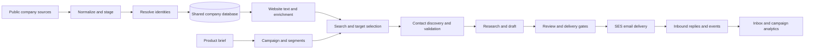

# Raliess — AI Go-to-Market Engine

Raliess is a self-hosted outbound sales system built in Python. It turns a product brief into a targeted campaign: collect company records, resolve duplicates, identify prospects, research their businesses, draft relevant outreach, send through an email provider, and process replies. A local dashboard gives the operator control over leads, campaigns, drafts, sending, and the inbox.

> **Portfolio edition:** This repository documents the complete system and shares 29 of its 58 application Python files as a screened source sample. The remaining application code, production data, credentials, prompts, deployment configuration, and operational integrations are private. This snapshot is not a runnable email platform.

## What I built

| Area | What the full system does |
| --- | --- |
| Data collection | Imports company records from public registries, open geographic datasets, and web indexes into resumable staging files. |
| Entity resolution | Normalizes names and domains, applies source provenance and trust rules, and uses DuckDB for disk-backed deduplication before updating SQLite. |
| Enrichment and search | Fetches useful website text, classifies companies, and maintains text and vector search paths for candidate discovery. |
| Campaign planning | Stores product briefs, generates customer segments, filters target companies, and assigns reachable contacts to campaigns. |
| AI-assisted writing | Uses company research and product facts to draft emails, checks output constraints, and retains drafts for review. |
| Delivery controls | Sends through Amazon SES with suppression, contact history, per-domain limits, verification, and send logging. |
| Reply handling | Imports inbound mail, links it to conversations, classifies intent, drafts replies, and routes sensitive cases for operator review. |
| Analytics and UI | Shows lead pools, campaign funnels, drafts, inbox threads, segment performance, and batch progress in a local FastAPI dashboard. |

## End-to-end flow

The data pipeline is shared across products. Campaigns read from that pool, so a new product does not require rebuilding the company database. Records and jobs are designed to be resumable and idempotent: repeated imports update known entities instead of creating another copy.

## Architecture and technical choices

- **Python 3.12, SQLModel, and SQLite:** transactional records for companies, people, contact points, campaigns, assignments, messages, suppressions, and send history. WAL mode supports concurrent readers while collectors and workers write.
- **DuckDB:** disk-backed passes for high-volume entity resolution and bulk data work. It avoids loading the entire company pool into Python memory.
- **HTTPX, Beautiful Soup, DNS tooling, and source-specific parsers:** website extraction, source ingestion, and address validation.
- **FastEmbed and USearch:** local embeddings and vector similarity for company discovery alongside indexed text search.
- **OpenAI-compatible model interface:** interchangeable local or hosted models for enrichment, segmentation, research, and writing. The active installation uses a local model with cloud access disabled.
- **FastAPI and Jinja2:** operator dashboard and a separate read-only data viewer.
- **Amazon SES, S3, and SQS:** outbound SMTP delivery, inbound email storage, and delivery-event processing in the full deployment.
- **Pytest:** offline checks for collectors, resolution, agents, sending, replies, optimization, and dashboard behavior.

## Engineering details

### One shared lead pool, multiple products

Companies and people are stored globally. A campaign links a product and its customer segments to selected contacts. A polymorphic `contact_points` model records reachability without tying the entire schema to email. Provenance is retained so the system can distinguish a verified site address from a weaker listing-derived address.

### Data quality before scale

Collection stages source records first, records per-source outcomes, and treats missing credentials or unavailable endpoints differently from malformed data. Resolution normalizes domains and names, rejects placeholder domains, and uses deterministic keys with source trust rules. Downstream selection can favor stronger contact evidence and suppress invalid or opted-out addresses.

### Controlled outreach

The production sender checks sendability and suppression before delivery, records contact history to avoid repeated outreach, and tracks per-domain and daily usage. Cold sends can be started as a bounded batch from the dashboard. Incoming replies are attached to the original conversation; reply automation defaults to drafting for operator review.

### Operations and visibility

The dashboard exposes campaigns, lead filters, drafted messages, conversation threads, inbox, escalations, batch status, and funnel metrics. The system also includes CLI reports and diagnostics for collection, resolution, deliverability, and data quality. Long-running jobs use checkpoints or persisted state so interrupted work can resume.

## Scale observed in the local deployment

Read-only database counts taken in October 2026:

| Measure | Count |
| --- | ---: |
| Companies | 24,766,237 |
| People | 3,393,704 |
| Contact points | 8,432,696 |
| Campaign assignments | 7,359 |
| Sent messages | 722 |
| Received messages | 23 |

These figures describe the local working database, not data included in this public repository. They show stored records and activity, not guaranteed contact accuracy or campaign effectiveness.

## What this repository includes

The `samples/` directory contains roughly half of the application Python files. It covers data collection and staging, entity resolution, website text, enrichment, contact discovery, search, and read-only dashboard queries. The samples are meant for code review. Internal campaign orchestration, full AI prompts, sending and reply workflows, credentials, lead records, message content, and production configuration are withheld.

## Current limitations

- The largest practical quality challenge is obtaining useful, current website text for each targeted business. A project audit found that many sampled targets lacked enough research material for genuinely specific messages.
- AI-written outreach still needs review. Internal evaluations found repetitive phrasing and occasional claims that were not supported by the available company evidence.
- This public snapshot is intentionally incomplete, so it cannot be used to reproduce production results or run a campaign.
- Some older internal planning documents predate implemented features. This README reflects the code and local data reviewed for this portfolio edition.

## Author

**Dhinesh Kumar B** — Python, data engineering, AI workflows, backend systems, and operator tooling.
