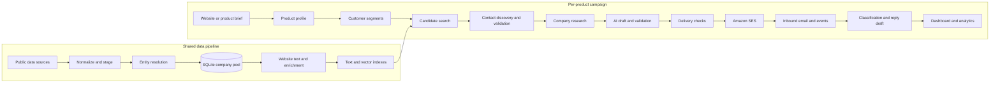

# Raliess — AI Go-to-Market Engine

Raliess is a self-hosted outbound sales system built in Python. It takes a product brief, finds businesses that may be a fit, identifies contact points, researches each company, drafts outreach, sends email, processes replies, and shows the whole funnel in a local dashboard.

> **Portfolio edition:** This README describes the full project, including private AI and email workflows. The repository contains 35 of the application's 58 Python source files, selected tests, dashboard templates, the schema, and dependencies for code review. It excludes production prompts, campaign orchestration, sending and reply implementations, credentials, customer records, messages, and deployment configuration. This snapshot cannot run a campaign by itself.

## The problem it solves

A small team promoting a product needs three things that are usually split across tools: a searchable company database, a way to decide which companies to contact, and a reliable workflow for personalized outreach and replies. Raliess connects those steps in one local system. The global company pool is built once and reused by multiple product campaigns; campaign work only enriches and promotes the records it actually needs.

## End-to-end architecture



The two pipelines are independent. Harvesting can continue without a campaign, and campaigns query the shared pool instead of re-importing the world. SQLite is the transactional store of record; DuckDB handles disk-backed bulk resolution.

## 1. Building the company and contact database

### Source collection

Source adapters read public company and place data from Overture Maps, OpenStreetMap, Common Crawl, GLEIF, SEC EDGAR, and business registries in the UK, Norway, Singapore, India, Belgium, and Canada. Adapters convert different upstream formats to one staging record. Each source has its own checkpoint and outcome status, so a missing key or unavailable endpoint does not silently look like a successful import. Staging is resumable and avoids rewriting unchanged records.

The system records source provenance alongside the resolved company. That matters later: a contact address found on a company's own website has different evidence from an old directory listing.

### Entity resolution and storage

The resolver normalizes domains and names, rejects junk or placeholder domains, uses source trust rules, and deduplicates records before upserting them into the global company table. DuckDB performs the bulk passes on disk. SQLite stores companies, source provenance, people, contact points, campaigns, segments, assignments, messages, suppressions, send logs, and contact history. WAL mode and targeted indexes support dashboard reads while workers write.

The contact model is channel-aware: a person can have an email address, phone number, or other contact point without adding a dedicated column for each channel. Campaign assignments connect a person and a chosen contact point to one product and segment.

### Website text, enrichment, and search

The web-text worker fetches company pages, strips page boilerplate, caches outcomes, and retries failures according to status. Enrichment uses available page text or source metadata to produce company descriptions, industry labels, and fit-oriented scores. Search combines indexed text queries with local embeddings through FastEmbed and USearch; candidate selection can also apply country, vertical, and segment filters.

Contact discovery mines published addresses, checks company sites, and can derive candidate patterns. Validation separates syntax, domain/MX checks, source confidence, and SMTP or external-verifier outcomes. The system ranks a verified or published address above an unverified guess, and unsupported guesses can be held from sending.

## 2. Turning a product into a campaign

A campaign can start from a product website or a written brief. The brief stores the product name, summary, value propositions, proof points, target customers, differentiation, tone, call to action, approved facts, and claims the writer must avoid. If a website cannot be read and no description is supplied, profiling reports an error instead of pretending to know the product.

A model proposes ideal-customer-profile segments with a fit score, buyer titles, pain-point angle, and search queries. Segment records are persisted, then matched against the company pool. Lead sourcing is scoped to the campaign: the system does not enrich every company in the global database just to prepare one outbound batch.

## 3. How the AI writing system works

The runtime model interface exposes lighter and stronger model roles through an OpenAI-compatible API. The lighter role handles high-volume extraction or research; the stronger role handles segmentation and message writing. Providers can be configured as local or hosted, with retry and fallback behavior. The current installation serves a quantized Gemma 4 31B model through `llama-server` with Metal acceleration and cloud model access disabled.

The production prompt text is private, but the **prompt workflow** is:

| Stage | Inputs | Expected output and check |
| --- | --- | --- |
| Product profile | Website text or operator description | Structured name, summary, value propositions, and proof points. Proof points must come from supplied material. |
| ICP design | Product profile and proof points | Structured segments, buyer roles, fit scores, angles, and search queries. |
| Lead research | Company description, website text, campaign brief | One specific observation supported by that company's evidence, or an empty result when no useful fact exists. |
| Cold-email draft | Product brief, allowed claims, recipient context, research observation, sender voice, and recent messages | Structured subject and body, followed by deterministic checks and revision attempts. |
| Reply draft | Latest inbound message, intent, product facts, sender identity, and the full conversation | A short contextual answer that does not repeat or contradict earlier replies. |

The writer's context has this shape; the values below are field names, not a production prompt or real prospect data:

```text
Product: summary, value propositions, approved proof, CTA, tone
Prospect: company, role, website evidence, one research observation
Boundaries: approved facts, forbidden claims, length and style rules
Variety: recent subjects and openings to avoid repeating
Return: structured subject and body for validation
```

### Personalization and grounding

The research stage asks for a detail a generic email to the entire trade could not have known. It can return nothing; an empty observation is preferable to a guessed one. The email writer gets the product's approved facts and restrictions, the recipient's company and role, and the research observation when available. It also sees recently used subjects and openings so it can vary the message rather than reproduce the same template.

### Draft validation and retries

The draft generator expects structured JSON, normalizes cosmetic issues, and checks constraints such as length, banned phrases, sign-offs, repeated subjects, similar openings, and product-brief guardrails. A rejected draft can be regenerated with its specific failures as feedback. If no fully clean version appears, a guardrail-clean candidate with minor style faults may be retained for review; a guardrail violation is not accepted as the fallback. Draft creation does not itself send email.

This is an engineering control, not a guarantee of factual accuracy. An internal evaluation found unsupported claims and repetitive wording when a targeted business had little usable website text. Human review remains important.

## 4. Delivery and reply workflow

### Cold outreach

The sender composes a message under a configured sender persona and uses Amazon SES SMTP for delivery. Before a cold send, it checks contact quality, suppressions, duplicate-address and contact-history rules, persona availability, enabled sending domain, and applicable limits. It stores the delivered body, provider ID, sender identity, and threading metadata so the inbox reflects what actually went out.

The dashboard provides an operator-started batch with a bounded target and pacing between sends. The separate background worker can refill drafts and poll replies. Automatic cold sourcing and sending are disabled in the current installation, so an operator starts cold batches deliberately. A batch has different scheduling behavior from the normal sender, but still checks suppression and address deduplication.

### Inbound mail and events

Inbound email is stored in S3, imported, parsed, and matched to a conversation using message headers and address history. SES events arrive through SQS and feed delivery and bounce tracking. The reply handler classifies intent, records unsubscribes and bounces, ignores ordinary out-of-office replies, and surfaces cases that need a person. A reply draft uses the entire thread and stays attached to the original sender persona.

The default reply behavior is draft-for-review. Optional automatic sending is restricted by global and per-campaign settings, allowed intent, and confidence; high-priority or uncertain cases are escalated instead. Reply sends are recorded separately from new cold outreach.

### Follow-ups and optimization

The optimization layer calculates sent, delivered, opened, clicked, replied, positive-reply, bounce, complaint, and suppression measures. It compares segments after a minimum sample and can mark them testing, working, scaling, or paused. It does not undo an operator's pause. Follow-up scheduling checks timing, reply state, suppression, and existing steps before creating another **draft**. Subject lines can be ranked by observed reply rate once they have enough sends.

## 5. Operator dashboard and tools

The FastAPI/Jinja dashboard has views for products, target segments, lead filters, draft review, inbox threads, escalations, batch progress, and campaign metrics. Actions include editing or discarding drafts, starting or stopping a batch, checking inbound mail, pausing a campaign, and changing model mode. A separate read-only viewer supports inspecting the company database. CLI commands and diagnostic scripts cover harvesting, resolving, lead quality, sending state, bounces, and data freshness.

## Technology stack

| Layer | Technologies |
| --- | --- |
| Runtime | Python 3.12 |
| Transactional data | SQLite, SQLModel, SQLAlchemy, WAL |
| Bulk resolution | DuckDB |
| Ingestion and extraction | HTTPX, Beautiful Soup, PyOsmium, DNS tooling |
| Search | SQLite FTS, FastEmbed, USearch |
| AI | OpenAI-compatible model interface; quantized Gemma 4 31B via `llama-server` and Metal in the current deployment; configurable hosted providers |
| Web UI | FastAPI, Jinja2, Uvicorn |
| Email and events | Amazon SES SMTP, S3, SQS, MIME and message threading |
| Verification and tests | Pytest, source reports, CLI diagnostics |

## Scale observed in the local deployment

Read-only database counts taken in October 2026:

| Measure | Count |
| --- | ---: |
| Companies | 24,766,237 |
| People | 3,393,704 |
| Contact points | 8,432,696 |
| Campaign assignments | 7,359 |
| Sent messages | 722 |
| Received messages | 23 |

These are stored-record and activity counts from the local working database. The data and message contents are not included here. The counts do not imply that every contact is current or that every campaign performed well.

## Reliability and current limitations

- Collectors and resolution stages are designed for resumable, idempotent work; large data passes run on disk rather than requiring the full pool in memory.
- Website research is the main quality bottleneck. In one internal 20-lead evaluation, almost all sampled targets lacked useful website text, and the generated outreach often had no concrete observation to use.
- The same evaluation found repetitive phrasing and unsupported integration claims in some drafts. Those findings are documented here as active quality limits, not presented as solved by the prompt checks.
- The private project has offline tests for its major phases. This public subset is intentionally not runnable because production modules and configuration are omitted.
- Older internal planning documents describe some later features as pending; this README follows the current implementation rather than those earlier plans.

## What is public in this repository

The repository is laid out like the application: [`app/`](app/) contains 35 of 58 Python modules, including collectors, resolution, enrichment, contact discovery, search, database models, product-brief handling, and read-only UI code. [`tests/`](tests/) contains selected offline tests. The root includes [`schema.sql`](schema.sql) and [`requirements.txt`](requirements.txt), while [`docs/CODE_MAP.md`](docs/CODE_MAP.md) identifies what each public module demonstrates. The remaining private modules include the campaign writer and prompt bodies, provider configuration, batch/sender internals, reply automation, production UI actions, and operational scripts. No credentials, local databases, customer records, or email content are published.

## Author

**Dhinesh Kumar B** — Python, data engineering, AI workflows, backend systems, and operator tooling.
